# Design resources deep-dive report: design thinking, visual language, and open resources for apps and games

Date: 2026-10-21 (Asia/Calcutta). Status: source-level deep dive, comparative synthesis, and owner-approved Tier 2 skill-reference updates complete; guidance corrected after owner review on 2026-10-21 (Section 11.1); project runtime pilots remain deferred until a target project is selected.

Related records: [Research brief and report plan](design-resources-report-plan-2026-10-21.md) · [React asset study](react-assets-study-2026-10-21.md) · [Complete reuse library download record](reuse-library-downloads-2026-10-21.md) · [Local resource selection guide](../RESOURCE_LIBRARY.md) · [Owner game asset inventory](../OWNER_GAME_ASSETS.md).

---

## 1. Executive decisions and scope

### Purpose and boundaries

This report completes the source-level deep dive across the owner's 10 supplied GitHub repositories, 2 GitHub topic feeds, and supplementary game/UI collections pinned locally on 2026-10-21. It answers three distinct engineering and design questions:

1. **What to learn**: How mature systems turn abstract principles into concrete token hierarchies, state machines, layout density rules, accessibility contracts, and tactile feedback.
2. **What to reuse in products**: Which components, styles, icons, sound cues, and game packs can be integrated directly into web, React Native, native Android, or game engine projects under their verified licenses.
3. **What to adopt into Engineer**: How to upgrade Engineer's reusable design thinking and language without bloating context budgets or violating redistribution licenses.

**Assumptions and scope notes**:
- The supplied `https://github.com/ant-design/ant-desig` URL is inaccessible; this report evaluates [ant-design/ant-design](https://github.com/ant-design/ant-design) (`v6.6.7`, commit `4e3564d0f308`) as the intended source.
- Source inspection was performed against immutable local snapshots in `artifacts/reuse-library/2026-10-21/` (36,114 extracted files across 21 collections) and `[local asset path] Assets` (19 owner archives, 14,552 extracted files).
- No upstream code, build scripts, or game engines were executed during this static audit. Runtime behavior, frame timing, and assistive-technology announcements remain verification gates for target project pilots.
- `catalog/apps.json` currently holds `apps: []`. Following owner confirmation in chat (`"yes"`, 2026-10-21), the bounded Tier 2 updates in Section 10 were applied to four skill reference files and `.codex/sources/design-lazy-2026-10-07.md`; no project repository or Engineer standard was modified.

### Prioritized decision matrix

| Resource | Primary role | Pinned revision / edition | Product reuse disposition | Toolkit (`Engineer`) disposition | Confidence & evidence level |
| --- | --- | --- | --- | --- | --- |
| [Ant Design](https://github.com/ant-design/ant-design) | Enterprise React UI & 3-tier token system | `4e3564d0f308` (`v6.6.7`, MIT) | **Reuse in React web** for complex forms, tables, and admin tools | **Learn & adapt** Seed → Map → Alias token architecture and loading/validation patterns | High (source + spec docs inspected) |
| [React Bits](https://github.com/DavidHDev/react-bits) | Animated React components, shaders & micro-interactions | `e12c22192ac7` (Custom MIT + Commons Clause) | **Selective product reuse** (copy needed TSX/CSS into product; preserve notice) | **Learn only; do not redistribute** in Engineer templates or public packs | High (218 components indexed; 6 deep-audited) |
| [daisyUI](https://github.com/saadeghi/daisyui) | Tailwind CSS semantic component & theme plugin | `bf3bac3a397b` (`v5.7.50`, MIT) | **Reuse in Tailwind web** for rapid multi-theme apps and semantic surfaces | **Learn & adapt** compact OKLCH semantic role + tactile variable vocabulary | High (CSS/theme source inspected) |
| [Vuetify](https://github.com/vuetifyjs/vuetify) | Vue 3 Material component & layout framework | `5ac58863f4ee` (`v4.3.0`, MIT) | **Reuse in Vue 3 web** for responsive shells, data tables, and Material flows | **Learn & adapt** orthogonal composable architecture (`density`, `variant`, `elevation`) | High (composable & component source inspected) |
| [Chakra UI](https://github.com/chakra-ui/chakra-ui) | React component system with Ark UI state machines | `fa9696f328ea` (`v3.37.0`, MIT) | **Reuse in React web** when custom brand recipes and strict accessibility are priority | **Learn & adapt** semantic tokens (`bg.*`, `fg.*`, `border.*`) and `slotRecipe` anatomy | High (token & recipe source inspected) |
| [Awesome Design Systems](https://github.com/alexpate/awesome-design-systems) | Curated directory of 150+ public design systems | `b366f8c3e24e` (MIT list; destinations vary) | **Reference only** (follow links to primary docs; check destination licenses individually) | **Curate reading map** (GOV.UK, USWDS, Carbon, Polaris, Pajamas, Cloudscape) | High (full table inspected) |
| [Vant](https://github.com/youzan/vant) | Mobile-first Vue 3 UI library | `dbf8019eae0d` (`v4.10.2`, MIT) | **Reuse in Vue mobile web**; translate concepts (not DOM code) to native mobile | **Learn & adapt** mobile bottom sheets, safe-area defaults, and scroll-parent lists | High (source inspected) |
| [UI/UX Design Library](https://github.com/justinhartman/ui-ux-design-library) | Categorized PDF reading list for UX/UI books | Upstream repo (Author copyrights retained) | **Do not copy PDFs** into products or repos | **Learn via curriculum**; trace titles to official publisher/author editions | High (README & copyright terms inspected) |
| [UI Kitten](https://github.com/akveo/react-native-ui-kitten) | React Native UI framework on Eva Design System | `e73dce62f946` (`v6.2.1`, MIT) | **Reuse in React Native**; verify RN `0.81+` / React `19` peer compatibility | **Learn & adapt** state-interaction dispatch (`useStyled`) and root modal vs inline trade-offs | High (source & tests inspected) |
| [React Suite](https://github.com/rsuite/rsuite) | Operational React UI & virtualized table suite | `f61a3ed41f2b` (`v6.2.5`, MIT) | **Reuse in React web** for date-heavy, schema-validated, or virtualized-table apps | **Learn & adapt** `autoLoading` promise buttons, `reduceMotion` context, and schema resolvers | High (source & license inspected) |
| [ux-ui-design](https://github.com/topics/ux-ui-design) & [ui-ux-design](https://github.com/topics/ui-ux-design) | GitHub community discovery feeds | Observed 2026-10-21 | **Screen strictly**; exclude portfolios, course dumps, and unverified agent skills | **Retain screening rubric**; use only to spot emerging open tools with clear licenses | Medium (feed volatility) |
| **Added Game & Native Shelf** (Kenney, Godot, Compose, Lucide, Owner Packs) | Cohesive game UI/audio/sprites, engine demos, Android samples, icons | Pinned 2026-10-21 (CC0, MIT, Apache-2.0, Mixed) | **Reuse directly** in games and apps per pack license (watch 4 noncommercial & 8 unknown owner packs) | **Indexed in local lookup** (`find_resource.py` + `RESOURCE_LIBRARY.md`) | High (hashes & notices verified) |

---

## 2. Source landscape: 10 repository dossiers and 2 topic feeds

### 2.1 Ant Design (`ant-design/ant-design`)
- **Pinned snapshot**: `4e3564d0f3088d0ef96210182732f579c38e5df3` (`v6.6.7`), 4,640 extracted files. License: MIT (`LICENSE`).
- **Audience & stack**: Enterprise React (`>=18`) web applications using TypeScript and CSS-in-JS / CSS variables (`@rc-component/*` primitives).
- **Design values & token architecture**:
  - Documented in `docs/spec/values.en-US.md`: **Natural** (reduce cognitive cost via visual hierarchy), **Certain** (low "cooperative entropy" via modular rules and restraint), **Meaningful** (clear goals, immediate feedback, flow matching skill), and **Growing** (discoverability and human-computer symbiosis).
  - Three-layer token derivation (`components/theme/interface/`):
    1. `SeedToken` (`seeds.ts`): Core brand and foundation inputs (`colorPrimary`, `colorSuccess`, `colorWarning`, `colorError`, `colorInfo`, `colorTextBase`, `colorBgBase`, `fontSize: 14`, `borderRadius`, `motionUnit`). Explicit source warning: *"Please DO NOT USE this Seed Token directly in the code!"*
    2. `MapToken` (`maps/index.ts`): Algorithmically derived palettes, neutral surface/text gradients, size scales, and motion speeds (`motionDurationFast`, `motionDurationMid`, `motionDurationSlow`).
    3. `AliasToken` & Component Tokens: Semantic aliases consumed by components, plus per-component overrides via `ConfigProvider`.
- **Five representative pattern observations**:
  1. **Button (`components/button/button.tsx`)**: Separates `color` (`default`, `primary`, `danger`, preset colors) from `variant` (`outlined`, `dashed`, `solid`, `filled`, `text`, `link`). Uses `getLoadingConfig` (`loading: boolean | { delay?: number }`) to prevent spinner flash on fast actions, and exposes granular semantic slot styling (`classNames`/`styles` for `root`, `icon`, `content`).
  2. **Form & Validation (`components/form/FormItem/index.tsx`)**: Wraps `@rc-component/form` with explicit `ValidateStatus` (`success`, `warning`, `error`, `validating`, `''`), `StatusProvider`, and `MemoInput` to avoid re-rendering untouched fields during high-frequency typing.
  3. **Modal (`components/modal/Modal.tsx`)**: Captures document click coordinates (`getClickPosition` within 100ms) so dialogs animate outward from the user's click origin rather than an arbitrary screen center. Integrates `ContextIsolator`, `ZIndexContext`, and `focusTriggerAfterClose`.
  4. **Navigation (`components/tabs/index.tsx`)**: Supports `line`, `card`, and `editable-card` tabs with overflow dropdowns (`more`), custom indicator sizing, and semantic slots (`root`, `item`, `indicator`, `header`, `body`).
  5. **Data Presentation (`components/table/Table.tsx`)**: Built on `@rc-component/table` with row selection (`SELECTION_ALL`, `SELECTION_INVERT`, `SELECTION_NONE`), expandable rows (`EXPAND_COLUMN`), sticky headers, and summary rows.
- **Caveats & disposition**: Heavy runtime footprint if imported unselectively; enterprise defaults (`14px` base font, dense controls) fit operational tools and game admin portals better than consumer mobile screens or active gameplay HUDs.

### 2.2 React Bits (`DavidHDev/react-bits`)
- **Pinned snapshot**: `e12c22192ac7b4b452c5e2feb9b586d74765d696`, 4,014 extracted files (218 components × 4 variants = 872 source combinations).
- **License boundary (`LICENSE.md`)**: **MIT + Commons Clause License Condition v1.0** (Copyright 2026 David Haz).
  - *Permitted*: Use, copy, modify, and distribute components and tool exports **as part of an application, website, or product** (including commercial/paid products) with copyright notice.
  - *Forbidden*: Selling, sublicensing, or redistributing the components, tools (`Background Studio`, `Texture Lab`, `Shape Magic`, `Center Stage`, `Sound Lab`), sounds, or standalone exports on their own, in a bundle, or as a ported library/template pack.
- **Architecture & dependency profile**:
  - Distributed as copy-paste or CLI-pulled (`shadcn` / `jsrepo`) source across `src/content` (JS+CSS), `src/tailwind` (JS+TW), `src/ts-default` (TS+CSS), and `src/ts-tailwind` (TS+TW).
  - Our static import scan (`artifacts/reuse-library/2026-10-21/index/REACT-BITS.md`) reveals four distinct weight tiers across the 218 components:
    1. *Zero external package imports (React + CSS/Canvas/WebGL only)*: e.g., `SpotlightCard`, `TiltedCard`, `ClickSpark`, `Aurora`, `Crosshair`, `ElectricBorder`, `GlareHover`, `Magnet`, `PixelTransition`, `StarBorder`.
    2. *2D/Timeline motion libraries*: `gsap` / `gsap/ScrollTrigger` (`AnimatedContent`, `FadeContent`, `ImageTrail`, `SplitText`) or `motion/react` (`CountUp`).
    3. *Lightweight WebGL (`ogl`)*: `CrystalizedBall`, `DitherVeil`, `ElectricLogo`, `EvilEye`, `MicroSlats`, `PatternWaves`, `RippleDistortion`.
    4. *Heavy 3D/Physics/Shader engines (`three`, `@react-three/fiber`, `matter-js`, `vgpu`)*: `BlobCursor`, `ColorBends`, `Hyperspeed`, `AeroShards`, `ShapeWaves`.
- **Representative mechanism findings (`docs/research/react-assets-study-2026-10-21.md`)**:
  - `TiltedCard` and `ClickSpark` include explicit keyboard activation and focus/ARIA branches alongside pointer math.
  - `Aurora` caps device-pixel ratio and cleans up `ResizeObserver` / WebGL resources on unmount, but its frame loop continues requesting `requestAnimationFrame` under `prefers-reduced-motion`—indicating that reduced visual movement alone may leave rendering work active; actual CPU/GPU and battery effects require runtime measurement.
- **Disposition**: High-value local source shelf for promotional web pages, game companion sites, launcher screens, and reward micro-interactions. Must never be re-bundled into Engineer's tracked templates.

### 2.3 daisyUI (`saadeghi/daisyui`)
- **Pinned snapshot**: `bf3bac3a397b543e55641ecb2d60a2ed961f09ec` (`v5.7.50`), 869 extracted files. License: MIT (`LICENSE`).
- **Audience & stack**: Framework-agnostic Tailwind CSS v4 plugin (`packages/daisyui`) using pure CSS layers (`@layer daisyui.l1.l2.l3`) and OKLCH color variables.
- **Token architecture (`packages/daisyui/src/themes/light.css`)**:
  - Remarkably compact 28-variable theme contract:
    - Surfaces & text: `--color-base-100`, `--color-base-200`, `--color-base-300`, `--color-base-content`.
    - Brand & semantic pairs (background + paired foreground content): `primary`/`primary-content`, `secondary`/`secondary-content`, `accent`/`accent-content`, `neutral`/`neutral-content`, `info`/`info-content`, `success`/`success-content`, `warning`/`warning-content`, `error`/`error-content`.
    - Shape, scale & tactile feel: `--radius-selector`, `--radius-field`, `--radius-box`, `--size-selector`, `--size-field`, `--border`, `--depth` (`0` or `1`), `--noise` (`0` or `1`).
- **Five representative pattern observations**:
  1. **Button (`src/components/button.css`)**: Uses CSS `color-mix(in oklab, ...)` to compute hover (`7%` darken), active (`5%` darken + `translate: 0 0.5px`), border, and 3D depth shadows (`calc(var(--depth) * 30%)`) dynamically from a single `--btn-color` variable. Guards hover styles with `@media (hover: hover)` to prevent sticky hover states on touchscreens.
  2. **Input (`src/components/input.css`)**: Uses `clamp(3rem, 20rem, 100%)` width, `outline-offset: 2px` on `:focus-within`, and includes an explicit mobile Safari fix (`@media (pointer: coarse) { @supports (-webkit-touch-callout: none) { &:focus-within { --font-size: 1rem; } } }`) as an iOS focus-zoom mitigation. This is the library implementation, not a universal guarantee: `1rem` follows the root font size, and actual computed size and zoom behavior require device testing.
  3. **Modal (`src/components/modal.css`)**: Supports native HTML `<dialog>` (`[open]`), Popover API (`[popover]`, `:popover-open`), `:target`, and checkbox toggles (`.modal-toggle:checked + &`), using modern `@starting-style` and `allow-discrete` transitions plus `:root:has(&) { --page-scroll-lock: ; }`.
  4. **Navigation (`src/components/tab.css`)**: CSS-only radio/ARIA tab strips (`[aria-selected="true"]`, `[aria-current="page"]`) with `:focus-visible` outlines (`outline: 2px solid currentColor; outline-offset: -5px`).
  5. **Data Presentation (`src/components/table.css`)**: Responsive `.table` with `.table-pin-rows` (`sticky top-0`), `.table-pin-cols`, `.table-zebra`, and five density scales (`table-xs` through `table-xl`).
- **Caveats & disposition**: Because daisyUI is pure CSS, it does **not** supply JavaScript focus trapping, ARIA live announcements, or keyboard roving tabindex for complex widgets. Pair its CSS vocabulary with semantic HTML (`<dialog>`, `
`) or headless behavior primitives.

### 2.4 Vuetify (`vuetifyjs/vuetify`)
- **Pinned snapshot**: `5ac58863f4ee4b8c089ad1fb52c408081f9cf8cb` (`v4.3.0`), 2,731 extracted files. License: MIT (`packages/vuetify/LICENSE.md`).
- **Audience & stack**: Vue 3 (`^3.5.0`) applications following Material Design 3 specifications.
- **Token & composable architecture**:
  - `packages/vuetify/src/composables/theme.ts`: Defines `BaseColors` (`background`, `surface`, `primary`, `secondary`, `success`, `warning`, `error`, `info`) and paired `OnColors` (`on-background`, `on-surface`, `on-primary`, etc.), automatically calculating foreground contrast via luminance (`getLuma`, `hasLightForeground`) when `on-*` colors are omitted. Respects `PREFERS_REDUCED_MOTION`.
  - Orthogonal prop factories: Almost every component composes `makeDensityProps` (`default`, `comfortable`, `compact`), `makeVariantProps` (`elevated`, `flat`, `tonal`, `outlined`, `text`, `plain`), `makeSizeProps`, `makeRoundedProps`, and `makeElevationProps`.
- **Five representative pattern observations**:
  1. **Button (`VBtn/VBtn.tsx`)**: Combines `useVariant` overlays (`genOverlays`), `useDensity`, `useLoader` (`VProgressCircular` slot), `vRipple` directive, router link integration, and group selection (`VBtnToggleSymbol`).
  2. **Input (`VTextField/VTextField.tsx`)**: Layers `VInput` (layout, messages, error/disabled state) around `VField` (visual container, floating label, clear icon, prefix/suffix) and `VCounter`, isolating validation layout from input chrome.
  3. **Dialog (`VDialog/VDialog.tsx`)**: Wraps `VOverlay` with `captureFocus: true`, `retainFocus: true`, `scrollStrategy: 'block'`, automatic `aria-haspopup="dialog"`, focus transfer into `contentEl` on `afterEnter`, and focus restoration to `activatorEl` on close.
  4. **Navigation (`VTabs/VTabs.tsx`)**: Built on `VSlideGroup` for touch/overflow pagination, paired with `VTabsWindow` and `density` scaling.
  5. **Data Presentation (`VDataTable/VDataTable.tsx`)**: Modular composables (`expand`, `group`, `headers`, `items`, `paginate`, `select`, `sort`) exposing strongly typed slot props (`VDataTableSlotProps<T>`).
- **Disposition**: Primary reference for Vue 3 projects and a cross-platform model for how `density` (`default` / `comfortable` / `compact`) and `variant` (`tonal` / `outlined` / `elevated`) should be orthogonal axes in any design system.

### 2.5 Chakra UI (`chakra-ui/chakra-ui`)
- **Pinned snapshot**: `fa9696f328ea5a0df8685c6d8460edbd779b63b9` (`@chakra-ui/react@3.37.0`), 2,409 extracted files. License: MIT (`LICENSE`).
- **Audience & stack**: React (`>=18`) applications using Emotion + Panda-style `styled-system` recipes and `@ark-ui/react` (`5.39.3`) headless state machines.
- **Token & recipe architecture**:
  - `packages/react/src/theme/semantic-tokens/colors.ts`: Cleanest role-based token hierarchy in the cohort. Every color family and semantic group defines standardized sub-roles with `_light` and `_dark` conditional values:
    - `bg`: `DEFAULT`, `subtle`, `muted`, `emphasized`, `inverted`, `panel`, `error`, `warning`, `success`, `info`.
    - `fg`: `DEFAULT`, `muted`, `subtle`, `inverted`, `error`, `warning`, `success`, `info`.
    - `border`: `DEFAULT`, `muted`, `subtle`, `emphasized`, `inverted`, `error`, `warning`, `success`, `info`.
    - Per-palette (`gray`, `red`, `blue`, etc.): `contrast`, `fg`, `subtle`, `muted`, `emphasized`, `solid`, `focusRing`.
  - Recipes (`defineRecipe` and `createSlotRecipeContext`): Separate single-part components (`buttonRecipe`) from multi-slot compound components (`field`, `dialog`, `tabs`, `table`).
- **Five representative pattern observations**:
  1. **Button (`theme/recipes/button.ts`)**: Defines 7 sizes (`2xs` to `2xl`) with coordinated height, horizontal padding, `textStyle`, gap, and `_icon` dimensions, plus `focusVisibleRing: "outside"` and `_disabled: { layerStyle: "disabled" }`.
  2. **Field (`components/field/field.tsx`)**: Compound slots (`FieldRoot`, `FieldLabel`, `FieldHelperText`, `FieldErrorText`, `FieldErrorIcon`, `FieldRequiredIndicator`) backed by `@ark-ui/react/field` for automatic `id`, `aria-describedby`, and `aria-invalid` wiring.
  3. **Dialog (`components/dialog/dialog.tsx`)**: Wraps `@ark-ui/react/dialog` with `defaultProps: { unmountOnExit: true, lazyMount: true }` and explicit slots (`Trigger`, `Backdrop`, `Positioner`, `Content`, `Title`, `Description`, `CloseTrigger`).
  4. **Navigation (`components/tabs/index.ts`)**: Exposes `TabsRoot`, `TabsList`, `TabsTrigger`, `TabsContent`, `TabsContentGroup`, and `TabsIndicator` over `@ark-ui/react/tabs`.
  5. **Data Presentation (`components/table/table.tsx`)**: Slot-recipe table supporting both explicit compound components (`TableRow`, `TableCell`, `TableScrollArea` with `-webkit-overflow-scrolling: touch`) and a `native` prop that styles plain HTML `<table>` children via nested selectors.
- **Disposition**: Benchmark reference for Engineer's semantic token naming (`bg/fg/border` × `DEFAULT/subtle/muted/emphasized/status`) and compound component anatomy.

### 2.6 Awesome Design Systems (`alexpate/awesome-design-systems`)
- **Pinned snapshot**: `b366f8c3e24e7411cc0a99a6c01edc3c7e19714d`, 2 extracted files (`README.md`, `LICENSE`).
- **What it contains**: A directory of ~150 design systems tagged across four dimensions: `Components`, `Voice & Tone`, `Designers Kit`, and `Source code` (with an explicit footnote warning: *"Projects marked as open source may not always be open to use. Always check the license of these projects before using them."*).
- **Six contrasting primary systems selected for Engineer's reading map**:
  1. **[GOV.UK Design System](https://design-system.service.gov.uk/)** ([source](https://github.com/alphagov/govuk-design-system)): Gold standard for plain-language task patterns ("Ask users for..."), single-thing-per-page form progression, error summaries at the top of the page linked to inline fields, and extreme accessibility verification.
  2. **[U.S. Web Design System (USWDS)](https://designsystem.digital.gov/)** ([source](https://github.com/uswds/uswds)): Exemplary token taxonomy (system tokens → theme tokens → component tokens → state tokens) and public-service accessibility rules.
  3. **[Shopify Polaris](https://polaris.shopify.com/)** ([source](https://github.com/Shopify/polaris)): Best-in-class merchant/operational UX patterns, actionable empty states, destructive action hierarchy, and concise microcopy ("Voice & Tone").
  4. **[GitLab Pajamas](https://design.gitlab.com/)** ([source](https://gitlab.com/gitlab-org/design.gitlab.com)): Deep engineering-workflow documentation covering data density, filter bars, skeleton vs spinner choice, and progressive disclosure.
  5. **[IBM Carbon](https://www.carbondesignsystem.com/)** ([source](https://github.com/ibm/carbon-components)): Rigorous 2x grid system, data visualization palettes, and four-step density/layering tokens (`$layer-01`, `$layer-02`, `$layer-03`) for dark and light enterprise dashboards.
  6. **[Atlassian Design System](https://atlassian.design/)** & **[Monzo Tone of Voice](https://monzo.com/tone-of-voice/)**: Practical models for writing clear, non-blaming error messages, confirmation dialogs, and status badges.

### 2.7 Vant (`youzan/vant`)
- **Pinned snapshot**: `dbf8019eae0d094385caa170c590ff73eea2b9b1` (`v4.10.2`), 1,392 extracted files. License: MIT (`LICENSE` + 10 subpackage MIT licenses).
- **Audience & stack**: Mobile-first Vue 3 (`^3.0.0`) web and hybrid e-commerce/consumer applications.
- **Token mechanism (`config-provider/ConfigProvider.tsx`)**: Converts camelCase `themeVars`, `themeVarsLight`, and `themeVarsDark` into `--van-*` CSS custom properties scoped locally or synced to `:root`, paired with global z-index management.
- **Five representative pattern observations**:
  1. **Button (`button/Button.tsx`)**: Mobile-specific `hairline` (`0.5px` border via `BORDER_SURROUND`), `square`/`round`, `block`, and separate `loadingText` / `loadingType` props so mobile buttons keep readable width during async submission.
  2. **Field (`field/Field.tsx`)**: Built on mobile `Cell` rows; handles IME composition (`startComposing`, `endComposing`), `enterkeyhint` (`send`, `search`, `next`, `done`), `inputAlign`, `clearTrigger` (`focus` vs `always`), `formatTrigger` (`onChange` vs `onBlur`), and mobile scroll reset (`resetScroll`).
  3. **Popup (`popup/Popup.tsx`)**: Unified primitive for center dialogs and top/bottom/left/right sheets; includes `safeAreaInsetTop`, `safeAreaInsetBottom`, `useLockScroll`, `useLazyRender`, `closeOnPopstate` (closes the popup on a history `popstate` event; does not itself consume Back or prevent route navigation), and `HAPTICS_FEEDBACK`.
  4. **Navigation (`tabbar/Tabbar.tsx`)**: Bottom navigation bar with `role="tablist"`, `safeAreaInsetBottom` enabled by default when `fixed`, `placeholder` height reservation (so fixed bottom bars never cover the last list item), and `beforeChange` interceptor support.
  5. **Data Presentation (`list/List.tsx`)**: Mobile infinite-scroll list (`direction="up" | "down"`, `offset=300`) that inspects `useScrollParent`, pauses checks when inside an inactive tab (`useAllTabStatus`), and renders explicit `loading`, `finishedText`, and tappable `errorText` retry states.
- **Disposition**: Best mobile-web reference in the cohort. Even for native Android Compose or React Native, Vant's handling of `closeOnPopstate`, fixed-bar `placeholder` reservation, IME composition, and tappable inline list retry states are transferable mobile UX patterns.

### 2.8 UI/UX Design Library (`justinhartman/ui-ux-design-library`)
- **Source status**: Inspected upstream README and copyright statement on 2026-10-21; intentionally excluded from bulk file downloading.
- **Rights boundary**: The repository hosts PDF copies of commercial design books while stating that copyrights belong to their respective authors/publishers. Under Engineer's provenance rules, publicly hosted third-party PDFs without open redistribution licenses **must not** be copied into Engineer or project repositories.
- **Curated 8-topic reading & exercise map (using authorized editions or primary author resources)**:
  1. *Interaction & Everyday Affordances* (Don Norman, *The Design of Everyday Things*): Signifiers, constraints, mappings, feedback, and slips vs mistakes → **Exercise**: Audit a game HUD or app form for missing signifiers and destructive slips.
  2. *Usability & Scanning* (Steve Krug, *Don't Make Me Think*): Visual hierarchy, conventions, omitting needless words, and "trunk test" navigation → **Exercise**: Run the trunk test on a deep mobile screen without prior context.
  3. *Refactoring UI & Visual Hierarchy* (Adam Wathan & Steve Schoger, *Refactoring UI*): Hierarchy via weight/contrast rather than font size alone, semantic grays, elevation shadows, and overlapping surfaces → **Exercise**: Redesign a flat card list using 3 surface levels and 3 text contrast steps before adding brand color.
  4. *Microinteractions* (Dan Saffer, *Microinteractions*): Trigger → Rules → Feedback → Loops & Modes → **Exercise**: Specify a complete microinteraction contract for a save/purchase button.
  5. *Typography in UI* (Ellen Lupton, *Thinking with Type* / Richard Rutter, *Web Typography*): Measure (`45–75ch`), tabular numerals (`font-variant-numeric: tabular-nums`) for timers/scores/prices, and vertical rhythm.
  6. *Forms & Input Recovery* (Luke Wroblewski, *Web Form Design* / GOV.UK patterns): Single-column flow, task-appropriate validation timing, preserving user input on error. GOV.UK recommends validating on continue/submit; earlier field validation needs supporting user research.
  7. *Mobile Touch & Ergonomics* (Steven Hoober / Josh Clark, *Designing for Touch*): Thumb zones, posture switching, and keeping primary actions away from system gesture edges.
  8. *Design Systems Governance* (Alla Kholmatova, *Design Systems*): Distinguishing rigid functional patterns from expressive brand modules.

### 2.9 React Native UI Kitten (`akveo/react-native-ui-kitten`)
- **Pinned snapshot**: `e73dce62f946e39c946ba4006dbd6c082d393161` (`@ui-kitten/components@6.2.1`), 1,279 extracted files. License: MIT (`LICENSE.txt`, `NOTICE`, `src/eva-icons/LICENSE`).
- **Maintenance & stack reconciliation**: Root `package.json` and `src/components/package.json` show active 2024–2026 maintenance (`Copyright (c) 2024-2026 Vlad Bataev and UI Kitten Contributors`), targeting `react: 19.1.0`, `react-native: 0.81.5`, and `turbo` workspaces, with `@styled` class decorators deprecated in favor of the `useStyled` hook (`src/components/theme/style/styled.tsx`).
- **Token & mapping architecture**:
  - Powered by Eva Design System (`@ui-kitten/processor` + `@ui-kitten/mapping-base`). Components request computed React Native `StyleSheet` objects from `useStyled(ComponentName, { appearance, status, size })` and dispatch runtime interaction states (`Interaction.ACTIVE`, `FOCUSED`, `DISABLED`, `HOVER`) via `dispatch([Interaction.ACTIVE])`.
- **Five representative pattern observations**:
  1. **Button (`ui/button/button.component.tsx`)**: Orthogonal `appearance` (`filled`, `outline`, `ghost`), `status` (`basic`, `primary`, `success`, `info`, `warning`, `danger`, `control` for high-contrast containers), and `size` (`tiny` to `giant`), dispatching `Interaction.ACTIVE` on `onPressIn` and clearing on `onPressOut`.
  2. **Input (`ui/input/input.component.tsx`)**: Wraps React Native `TextInput` with `status`, `label`, `caption`, `accessoryLeft`/`Right`, `accessibleInputName` computation, and separate `textInputRef` vs imperative `InputRef` (`focus`, `blur`, `isFocused`, `clear`).
  3. **Modal (`ui/modal/modal.component.tsx`)**: Documents two critical native mobile engineering lessons directly in source comments:
     - *Root panel vs inline rendering*: Presenting modals from the root `ApplicationProvider` avoids keeping the modal inside an enclosing `ScrollView` (where the first tap is swallowed to dismiss the soft keyboard instead of activating the modal button), while `renderInline` preserves local React contexts.
     - *Orientation lock bug (`#1911`)*: React Native's native `Modal` defaults to portrait-only if `supportedOrientations` is omitted, causing landscape iPad popovers to rotate the screen; UI Kitten explicitly passes `ALL_ORIENTATIONS`.
  4. **Navigation (`ui/bottomNavigation/bottomNavigation.component.tsx`)**: Tab bar with animated `TabIndicator` and direct React Navigation `tabBar` adapter pattern.
  5. **Data Presentation (`ui/list/list.component.tsx`)**: Thin Eva-styled wrapper around React Native `FlatList` forwarding `scrollToEnd`, `scrollToIndex`, and `scrollToOffset`.
- **Disposition**: Strong React Native reference and a valuable source of native mobile state/modal edge cases (`supportedOrientations`, scroll-view keyboard tap swallowing).

### 2.10 React Suite (`rsuite/rsuite`)
- **Pinned snapshot**: `f61a3ed41f2b12cc9543f2a104624c54822627ca` (`v6.2.5`), 3,508 extracted files. License: MIT (`LICENSE` verified in local archive, resolving the earlier planning-pass raw fetch failure; `tooling/mcp/LICENSE` also MIT).
- **Audience & stack**: Operational React (`>=18`) web applications, data dashboards, and admin tools (`rsuite-table`, `date-fns`, `schema-typed`, `react-window`).
- **Theme & provider architecture (`src/CustomProvider/CustomProvider.tsx`)**: Centralizes `theme` (`light`, `dark`, `high-contrast`), `rtl`, `locale`, `csp`, `reduceMotion`, and portal-backed `ToastContainer` / `DialogContainer` instances.
- **Five representative pattern observations**:
  1. **Button (`src/Button/Button.tsx`)**: Features `autoLoading`—when `onClick` returns a Promise, the button automatically enters its loading state and blocks duplicate clicks until the promise settles, routing unhandled rejections to `onClickError`. Also checks `reduceMotion` from `CustomContext` before rendering `Ripple`.
  2. **Form (`src/Form/Form.tsx`)**: Combines `FormErrorSummary` (top-of-form accessible error list), `schema-typed` models, and an async/sync `resolver` prop compatible with Zod, Yup, Valibot, and AJV.
  3. **Modal (`src/Modal/Modal.tsx`)**: Supports both dialog and drawer (`isDrawer`) presentation, `overflow` auto-height calculation, `bodyFill` for split-panel/gallery dialogs, and `useReducedMotion` to disable `Bounce` transitions automatically.
  4. **Navigation (`src/Nav/Nav.tsx`)**: Menubar-backed navigation (`@/internals/Menu/Menubar`) with `AdaptiveNavItem`, `NavMegaMenu`, and explicit deprecation warnings guiding developers from `appearance="pills"` to `SegmentedControl`.
  5. **Data Presentation (`src/Table/Table.tsx`)**: Wraps `rsuite-table` (`v5.19.2`) with virtualized scrolling, fixed columns, tree tables, and RTL/locale injection.
- **Disposition**: Ideal reference for data-dense operational tools; `autoLoading` buttons, `FormErrorSummary`, and `high-contrast` theme support are standout patterns to adopt across Engineer's web guidance.

### 2.11 & 2.12 GitHub Topic Feeds (`topics/ux-ui-design` and `topics/ui-ux-design`)
- **Observation & deduplication**: Both topic feeds mix high-signal open-source design tools with student portfolios, static Figma export dumps, clone courses, and unverified third-party AI agent skill packs.
- **Screening gate established for Engineer**:
  - **Accept for study/reuse** only repositories with: (a) clear open-source license in the repo root, (b) working component/token/asset source or verifiable primary documentation, and (c) active maintenance or self-contained static assets.
  - **Reject**: Course homework/portfolios (no reusable architecture), scraped book/kit dumps without author permission, and third-party agent prompt/skill repos (violates `AGENTS.md` authority order and supply-chain safety).
- **Five high-value open ecosystem categories surfaced by topic cross-referencing (and how our local library covers them)**:
  1. *Open vector icon systems*: Covered locally by **Lucide** (`lucide-icons/lucide` at `20aef31db93f`, 1,903 SVGs, ISC + MIT Feather notice).
  2. *Headless accessible UI primitives*: **Ark UI** (already embedded inside our Chakra UI v3 snapshot) and **Radix UI** / **Base UI** (listed in Awesome Design Systems).
  3. *Open-source design/prototyping tools*: **Penpot** (`penpot/penpot`, MPL-2.0)—useful web-standards SVG/CSS design tool reference when teams do not use Figma.
  4. *Native Android reference architectures*: Covered locally by **Google Official Compose Samples** (`android/compose-samples` at `0bc770fd2851`, Apache-2.0: `JetNews`, `Jetsnack`, `Jetchat`, `Jetcaster`, `JetLagged`, `Reply`).
  5. *Game UI & engine reference projects*: Covered locally by **Godot Demo Projects** (`b761b4cd5718`, 61 demos) and **9 Kenney CC0 packs** (8,513 files).

---

## 3. Design thinking: from abstract values to observable decisions

Borrowing slogans like "Natural" or "Modern" does not improve software. Across Ant Design, GOV.UK, Polaris, and Material/Compose, strong design thinking translates every principle into an **observable decision**, a **measurable constraint**, and a **counterexample (failure mode)**.

| Principle | Observable design decision | Counterexample / failure mode | Verification check |
| --- | --- | --- | --- |
| **1. One primary job per screen or region** (GOV.UK, `mobile-product-design`) | Name the single primary action before choosing layout. Give at most one control per view the highest-contrast `primary` fill; demote secondary actions to `outline`, `subtle`, or `ghost`. | Three equally bright primary buttons ("Save", "Export", "Share") competing in the same header or card footer. | Squint test / monochrome check: the primary action remains unmistakable without reading labels. |
| **2. Progressive disclosure over upfront clutter** (Ant Design *Restraint*, Pajamas) | Show the 3–5 fields or stats needed for 80% of sessions; place advanced filters, raw logs, or secondary metadata in expandable drawers, popovers, or detail tabs. | Exposing 18 filter dropdowns above a table on initial load, pushing the actual data below the fold on a laptop screen. | Measure viewport allocation: primary task content occupies the majority of the first screen at target resolution. |
| **3. Deterministic state & async certainty** (Ant Design *Certain*, React Suite `autoLoading`) | Model pending, success and failure for async actions; immediately guard repeat activation where duplication is unsafe. Choose progress feedback and any spinner delay from task and latency evidence. | Clicking "Submit" or "Buy" twice fires duplicate network mutations or leaves the user staring at an unchanged button during a 2s request. | Throttle network to Slow 3G; verify pointer/keyboard repeat protection, progress feedback without flicker or unexplained waiting, and error recovery with user input preserved. |
| **4. Prevent slips before blaming mistakes** (Norman, Vant, UI Kitten) | Separate destructive triggers spatially from routine confirmation buttons; use undo for reversible actions and explicit confirmation dialogs for irreversible ones. | Placing "Delete Account" or "Abandon Run" immediately adjacent to "Save Settings" or "Resume" with identical button styling. | Mis-tap audit around thumb edges and fast pointer travel paths. |
| **5. Content and layout resilience** (GOV.UK, Godot `pseudolocalization` & `ui_mirroring`) | Design containers to survive `30–40%` string expansion, `200%` text zoom, multi-line wrapping, empty states, and RTL mirroring without clipping or overlapping siblings. | Fixed-height `40px` buttons or HUD banners that truncate German/Hindi translations or overlap icons when system font scale is set to Large. | Exercise with longest realistic localized strings, empty data, and `200%` font/zoom scale. |

---

## 4. Visual language and cross-system token architecture

### 4.1 Cross-system token comparison

Inspecting the actual theme source files across our pinned repositories shows how modern systems converge on a **3-tier token model** (Primitives → Semantic Roles → Component/Slot Tokens):

| Token role / concept | Ant Design (`v6.6.7`) | Chakra UI (`v3.37.0`) | daisyUI (`v5.7.50`) | Vuetify (`v4.3.0`) | UI Kitten / Eva (`v6.2.1`) |
| --- | --- | --- | --- | --- | --- |
| **Base / Default Surface** | `colorBgContainer` (from `colorBgBase`) | `bg.DEFAULT` (`white` / `black`) | `--color-base-100` (OKLCH) | `surface` | `background-basic-color-1` |
| **Subtle / Sunken Surface** | `colorBgLayout` | `bg.subtle` (`gray.50` / `gray.950`) | `--color-base-200` | `background` / `surface-light` | `background-basic-color-2` |
| **Muted / Card / Hover Surface** | `colorFillAlter` / `colorBgElevated` | `bg.muted` / `bg.panel` | `--color-base-300` | `surface-bright` / `surface-variant` | `background-basic-color-3` |
| **Primary Foreground Text** | `colorText` (from `colorTextBase`) | `fg.DEFAULT` (`black` / `gray.50`) | `--color-base-content` | `on-surface` (auto-luma) | `text-basic-color` |
| **Secondary / Muted Text** | `colorTextSecondary` / `colorTextTertiary` | `fg.muted` (`gray.600` / `gray.400`) | `color-mix(base-content 60%)` | `on-surface` + medium-emphasis opacity | `text-hint-color` |
| **Default Border / Divider** | `colorBorder` / `colorBorderSecondary` | `border.DEFAULT` (`gray.200` / `gray.800`) | `color-mix(base-content 20%)` | `border-color` + `border-opacity` | `border-basic-color-3` |
| **Brand Primary + Contrast Text** | `colorPrimary` + `colorTextLightSolid` | `colorPalette.solid` + `colorPalette.contrast` | `--color-primary` + `--color-primary-content` | `primary` + `on-primary` | `color-primary-default` + `text-control-color` |
| **Status Semantics** | `colorSuccess`, `colorWarning`, `colorError`, `colorInfo` | `status` (`error`, `warning`, `success`, `info` on `bg`/`fg`/`border`) | `--color-success`, `--color-warning`, `--color-error`, `--color-info` (+ `-content`) | `success`, `warning`, `error`, `info` (+ `on-*`) | `status`: `success`, `info`, `warning`, `danger`, `basic`, `control` |
| **Shape & Tactile Modifiers** | `borderRadius`, `lineWidth`, `boxShadow` | `radii.l1` / `l2` / `l3`, `shadows` | `--radius-field`, `--radius-box`, `--border`, `--depth`, `--noise` | `rounded`, `elevation` (`0–24`) | Component mapping (`borderRadius`, `borderWidth`) |

### 4.2 Candidate token contract for new systems

Preserve existing project tokens and platform conventions. For a new system, consider the three-layer example below to separate foundations, roles and component recipes. Adapt names and layers to actual needs; this model does not guarantee theme changes require no layout work.

```mermaid
flowchart LR
    subgraph Layer1["1. Primitive Scales (Private)"]
        P1["Palette (OKLCH / Hex ramps 50–950)"]
        P2["Space & Size (4px / 4dp base grid)"]
        P3["Type Scale & Weights (Sans, Display, Mono)"]
        P4["Motion Curves & Durations (120ms, 200ms, 320ms)"]
    end

    subgraph Layer2["2. Semantic Role Tokens (Public API)"]
        S1["Surfaces: bg.canvas, bg.surface, bg.elevated, bg.overlay"]
        S2["Text & Icons: fg.default, fg.muted, fg.subtle, fg.onAccent"]
        S3["Borders & Focus: border.subtle, border.strong, ring.focus"]
        S4["Intents: accent.primary, status.success/warning/danger/info"]
        S5["Tactile Modifiers: radius.control/panel, depth, density"]
    end

    subgraph Layer3["3. Component & Slot Recipes"]
        C1["Control Anatomy: root, label, indicator, helper, error"]
        C2["Orthogonal Axes: variant (solid/soft/outline/ghost) x size x density"]
        C3["Interactive States: default, hover, pressed, focusVisible, loading, disabled"]
    end

    Layer1 --> Layer2 --> Layer3
```

### 4.3 Three coherent visual directions (comparison briefs)

Instead of defaulting to generic unstyled templates, projects should explicitly pick and document a visual direction suited to their user context:

| Dimension | Direction A: Information-Dense Operational Utility | Direction B: Calm Consumer Product | Direction C: Expressive Game Shell & HUD |
| --- | --- | --- | --- |
| **Target use cases** | Admin consoles, analytics, inventory/level editors, developer tools (Ant Design, React Suite, Carbon) | Everyday mobile/web apps, reading, finance, wellness, booking (Chakra UI, Vant, Compose `JetNews`) | Game title screens, pause/inventory menus, HUD overlays, reward reveals (Kenney UI, Paper UI, Godot GUI) |
| **Surface hierarchy** | Crisp `1px` structural borders (`border.subtle`), low shadow depth, compact layered panels (`bg.canvas` → `bg.surface`). | Generous whitespace, soft tonal containers (`bg.subtle` / `bg.muted`), subtle elevation shadows, minimal visible borders. | High-contrast framed panels (9-slice sprites, bevels, or dark translucent HUD plates over active playfields) with clear silhouette separation. |
| **Typography & numbers** | `13–14px` body, tight line-height (`1.35`), use `tabular-nums` for numeric columns or changing values where stable alignment helps. | `15–16px` body (`14–16sp` Android), comfortable line-height (`1.5`), clear editorial display headings. | Distinct display/title font (e.g., `Kenney Fonts` or bold geometric sans) paired with highly legible sans/mono for fast-changing counters (`tabular-nums` + outer stroke/drop shadow). |
| **Density & spacing** | `compact` (`32px` control height, `8–12px` cell padding) to maximize visible rows without scrolling. | `comfortable` (`40–48px` / `48dp` touch targets, `16–24px` section spacing) for effortless thumb reach. | **Bimodal**: `0%` clutter in central playfield; oversized (`>=48dp` with safe margin) thumb controls in screen corners; rich grid slots in full-screen inventory modals. |
| **Motion & feedback** | Fast, functional transitions (`100–150ms`), delayed spinners, zero decorative background motion. | Smooth spatial choreography (`180–250ms` ease-out sheets, shared-element transitions, subtle haptics). | Immediate `<16ms` input press acknowledgement (scale/sprite swap + audio cue), juicy reward reveals (`CountUp`, `ClickSpark`, particles), strict `reduceMotion` / screen-shake toggle. |

---

## 5. Interaction, state matrices, content, and motion rules

### 5.1 Cross-component interactive state matrix

Use the following as a checklist of applicable states; not every state belongs to every component. Choose native semantics and platform behavior for each control.

| State | Visual & token signal | Pointer / Touch behavior | Keyboard & Assistive Tech (AT) contract | Source exemplar |
| --- | --- | --- | --- | --- |
| **Default (Rest)** | Semantic variant tokens (`solid`, `soft`, `outline`, `ghost`) | Ready; hit target `>=48dp` (mobile) or `>=32px` (desktop compact) | Focusable in logical tab order (`tabIndex={0}` or native control) | Chakra `buttonRecipe`, Compose defaults |
| **Hover** | Subtle luminance shift (`5–8%` via `color-mix` or palette step) | Apply **only** inside `@media (hover: hover)` so touch taps don't stick | N/A (do not confuse hover with keyboard focus) | daisyUI `button.css` (`@media (hover: hover)`) |
| **Focus-Visible** | High-contrast outer ring (`2px solid`, `2px` offset) | Suppressed on plain pointer click via `:focus-visible` | Mandatory visible ring on `Tab` / D-pad / controller navigation | Chakra `focusVisibleRing: "outside"` |
| **Pressed / Active** | `translate: 0 0.5px` or `0.97` scale; flattened shadow; active sprite/color | Triggered on `pointerdown` / `onPressIn`; cancels cleanly if finger drags off | Triggered on `Space` / `Enter` (`ClickSpark` / `TiltedCard` keyboard branch) | daisyUI `button.css`, UI Kitten `useStyled`, Kenney pressed sprites |
| **Loading / Pending** | Inline spinner replacing icon or alongside `loadingText`; width locked | Guard unsafe repeat activation in the handler (`autoLoading` where supported); CSS pointer blocking alone misses keyboard/programmatic activation | Keep focus on control; set `aria-busy="true"` or announce status; choose spinner delay from latency/task evidence; pending protection is immediate | Ant Design `getLoadingConfig`, React Suite `autoLoading` |
| **Disabled** | Reduced opacity (`0.4–0.5`) or muted tokens; no elevation shadow | Ignores press; avoid showing misleading hover cursors | Native `disabled` or `aria-disabled="true"` (use `aria-disabled` when focus/tooltip explanation is needed) | React Suite `isDisableableElement`, Chakra `layerStyle: "disabled"` |
| **Invalid / Error** | `border.error` + `fg.error` icon/message below field (never color alone) | Clicking error summary jumps to and focuses the field | `aria-invalid="true"`, `aria-describedby` linked to `FieldErrorText` ID | Chakra `ArkField`, React Suite `FormErrorSummary`, GOV.UK |
| **Selected / Checked** | Distinct indicator bar, checkmark icon, or `solid`/`tonal` fill | Supports toggle or single-select group rules | `aria-selected="true"`, `aria-checked="true"`, or `aria-current="page"` | Vuetify `VTabs`, daisyUI `tab.css` |
| **Empty / Offline** | Quiet illustration/icon, plain explanation of *why*, and 1 recovery CTA | Recovery button retries fetch or opens creation flow | Accessible heading/region; announced when filter yields 0 results | Vant `List` (`errorText` / `finishedText`), Polaris empty states |

### 5.2 Purposeful motion specification (learned from React Bits, Ant Design, and RSuite)

Motion is an interaction decision, never filler. Before adding any animation or shader from React Bits or an engine tween:
1. **Name the job**: Does it orient the user in space (e.g., Ant Modal zooming from click point, Vant Popup sliding from bottom), confirm an action (`ClickSpark`), smooth a state change (`CountUp`), or establish mood on an idle title screen (`Aurora`)? If none, omit it.
2. **Choose timing for the task** (illustrative starting ranges, not universal requirements):
   - Micro-feedback (button press, toggle, spark): `80–150ms`.
   - Component transitions (modals, drawers, tabs, tooltips): `180–280ms` (`ease-out` enter, `ease-in` exit).
   - Ambient/background shaders: Low frequency, low contrast behind text, paused when offscreen (`IntersectionObserver` / `document.visibilityState`).
3. **Verify the `prefers-reduced-motion` contract**:
   - Reduce or replace nonessential movement; a still alternative may fit better than a fade. When using a static decorative fallback, stop its redundant `requestAnimationFrame` / shader loop. Preserve rendering needed for content, interaction or gameplay. Verify preference changes, cleanup and runtime cost in the target implementation.

### 5.3 Microcopy & voice rules (learned from GOV.UK, Polaris, and Monzo)

- **Action labels**: Use `[Verb] + [Specific Noun]` ("Save character", "Export CSV", "Retry connection") instead of vague labels ("OK", "Submit", "Yes").
- **Error messages**: State (1) what went wrong in plain language without blaming the user or dumping raw stack codes, and (2) how to fix it ("Enter a port between 1024 and 65535").
- **Destructive confirmations**: Title with the exact consequence ("Delete project 'Apollo'?") and label the buttons `"Delete project"` (`danger`) vs `"Keep project"` (`outline`/`neutral`)—never `"Yes"` / `"Cancel"`.

---

## 6. App application guide and task case studies

### 6.1 Platform & stack selection matrix

Do not mix competing component frameworks in a single project. Pick one primary implementation source that matches the target platform:

| Target stack | Primary code/component shelf | Icon & asset shelf | Key platform translation rules |
| --- | --- | --- | --- |
| **React Web (Enterprise / Admin / Data Tools)** | **Ant Design (`v6.6.7`)** or **React Suite (`v6.2.5`)** | `@ant-design/icons`, `@rsuite/icons`, or **Lucide** | Use built-in virtualized `Table`, schema/field validation, and `ConfigProvider`/`CustomProvider` tokens. Do not layer Tailwind component libraries on top unless scoped. |
| **React Web (Custom Brand / Consumer / Marketing)** | **Chakra UI (`v3.37.0`)** or **Tailwind + daisyUI (`v5.7.50`)** + selective **React Bits** | **Lucide** (`1,903` SVGs) + selective **React Bits** (`TS-CSS` / `TS-TW`) | Use Chakra `slotRecipes` or daisyUI semantic themes for core UI; pull individual React Bits components (`SpotlightCard`, `CountUp`, `AnimatedContent`) only for hero/feature moments. |
| **Vue 3 Web (Desktop / Responsive)** | **Vuetify (`v4.3.0`)** | Material Icons / **Lucide** | Leverage `density="compact" | "comfortable"`, `VDataTable`, and `VDialog` focus management. |
| **Vue 3 Mobile Web / Hybrid** | **Vant (`v4.10.2`)** | `@vant/icons` / **Lucide** | Apply safe-area and layout reservation where required. Coordinate sheet Back behavior with router/history design; `closeOnPopstate` only reacts to a history change. |
| **React Native (iOS / Android)** | **UI Kitten (`v6.2.1`)** | Eva Icons / **Lucide** (`react-native-svg`) | Render blocking modals via root `ApplicationProvider` (not inline inside `ScrollView`), pass `ALL_ORIENTATIONS`, and map tokens via `useStyled`. |
| **Native Android (Jetpack Compose)** | **Google Official Compose Samples** (`0bc770fd2851`) + Material 3 | Material Symbols / **Lucide** converted to Android Vector Drawables (`graphics-assets`) | Translate conceptual lessons (semantic color roles, state hoisting, adaptive panes from `Reply`/`JetNews`) into idiomatic Kotlin/Compose; never port web DOM/CSS assumptions. |

### 6.2 Three concrete app task case studies

#### Case Study 1: Complex Creation & Editing Form with Recovery
- **Sources combined**: GOV.UK form structure + Chakra UI `Field` slot anatomy + React Suite `FormErrorSummary` & `autoLoading` button + daisyUI iOS input zoom guard.
- **Specification**:
  1. Single-column vertical flow with explicit `FieldLabel`, optional `FieldHelperText` *above* or *below* the control (never inside `placeholder`, which disappears on typing), and `FieldErrorText` wired via `aria-describedby`.
  2. Choose validation timing from task/user evidence. For GOV.UK-style staged forms, validate on continue/submit; use earlier validation only when evidence supports it. Preserve input and make corrections discoverable without interrupting unfinished entry.
  3. On submit failure, focus an accessible `FormErrorSummary` banner at the top of the form that lists each invalid field as an anchor link, preserve all user-typed values, and use an `autoLoading` submit button so slow networks cannot trigger double submissions.

#### Case Study 2: High-Density Operational List / Data Table
- **Sources combined**: Ant Design `Table` + Vuetify `VDataTable` composables + React Suite virtualized `rsuite-table` + Vant `List` retry states.
- **Specification**:
  1. Toolbar exposes search, active filter chips, a "Clear all filters" action, and a `density` toggle (`comfortable` vs `compact`).
  2. Numeric columns right-align and enforce `font-variant-numeric: tabular-nums`; sticky headers (`.table-pin-rows`) keep column context visible during scroll.
  3. Distinguish three non-data states: **Initial Loading** (skeleton rows matching table geometry), **Refetching / Filtering** (subtle top progress bar while keeping existing rows interactive/visible), and **Zero Results vs Fetch Error** ("No items match filter 'Active'" + `[Reset filters]` button vs "Could not load items" + `[Retry]` button).

#### Case Study 3: Mobile-First Multi-Step Task & Bottom Sheet
- **Sources combined**: Vant `Popup` / `Tabbar` / `Field` + UI Kitten `Modal` & `BottomNavigation` + Compose `Jetchat` / `Jetsnack`.
- **Specification**:
  1. Primary navigation uses a bottom bar (`48dp+` targets, `safeAreaInsetBottom`, and layout `placeholder` padding so content never hides behind the bar).
  2. Secondary contextual sub-tasks (e.g., selecting sort order, editing an address, confirming a purchase) open in a bottom sheet (`Popup position="bottom" round safeAreaInsetBottom`) rather than navigating away and losing scroll position.
  3. Specify and test Back so an open sheet dismisses before leaving the screen. On web, coordinate router/history behavior explicitly: `closeOnPopstate` closes after history changes and does not prevent navigation. On Android, use the project's sheet/back integration. Test keyboard dismissal and first-tap behavior; root presentation alone does not prove them.

---

## 7. Game application: shells, active-play HUDs, feel, and engine demos

App UI libraries and game UI solve fundamentally different problems during active play: in an app, the UI **is** the workspace; in an action or spatial game, the UI is an **overlay on a live camera and simulation**.

### 7.1 Separating game interface zones

| Game UI zone | Applicable app-library lessons | Game-specific rules (`mobile-game-ux`, Godot demos, Kenney packs) |
| --- | --- | --- |
| **1. Title, Launcher & Meta-Progression Shell** | Token hierarchy, tab bars (`BottomNavigation`), card grids (`SpotlightCard` / `TiltedCard` motifs), modal focus/back rules, settings forms (`Field`, sliders, toggles). | Establish genre mood immediately (e.g., `UI Pack — Sci-Fi` vs `Paper UI System`); support controller/D-pad focus rings as well as touch; keep "Play / Continue" as the unmistakable primary button. |
| **2. Active-Play HUD** | Semantic color coding (`danger`/`warning`/`success`), `tabular-nums` for scores and timers, high contrast (`OnColors`). | **Preserve the playfield**: anchor HUD to corners/edges respecting `WindowInsets`/safe areas and TV/monitor overscan margins (`gui/multiple_resolutions`). Use dark backing plates or 2px outer strokes so text stays readable over bright explosions or snow. Never let decorative animations block touch input. |
| **3. Touch Controls & Aiming** | Density-aware hit targets (`>=48dp`), pressed state dispatch (`onPressIn`/`onPressOut`). | Track stable pointer IDs across multi-touch (`mobile/multitouch_view`, `mobile/multitouch_cubes`); separate movement thumb from action/aim thumb; keep predicted trajectories/reticles (`Crosshair`) offset above finger occlusion. |
| **4. Pause, Inventory & Shop Overlays** | Modal scroll locking, tabs, grid selection, clear close/back actions. | Explicitly define simulation contract: **Pause menu** halts physics/timers and gates gameplay input polling so the closing tap does not fire a weapon into the game world. |
| **5. Round Result & Reward Flow** | `CountUp` number rollups, `ClickSpark` celebratory bursts, clear primary (`Play Again` / `Next Level`) vs secondary (`Menu`) hierarchy. | Allow players to tap once to skip slow tally animations to the final score immediately; ensure retry is reachable in 1 tap without reloading heavy static assets (`loading/load_threaded`). |

### 7.2 Concrete lessons from our 61 local Godot demo projects

Inspecting `artifacts/reuse-library/2026-10-21/sources/godotengine--godot-demo-projects/` provides executable blueprints for engine UI problems that web libraries do not cover:

1. **Resolution, Aspect Ratio & Overscan (`gui/multiple_resolutions`)**:
   - Uses `canvas_items` stretch mode + `expand` aspect ratio + MSDF fonts (`gui/msdf_font`) so UI scales crisply across phone portrait, 16:9, 16:10 (Steam Deck), and ultrawide monitors without blurring rasterized text.
   - Constrains HUD aspect ratio on ultrawide screens (so health/minimap aren't stranded in peripheral vision) while providing an overscan margin slider (`10–30px`) for TVs and curved mobile corners.
2. **Runtime Theme & Stylebox Overrides (`gui/theming_override`)**:
   - Demonstrates how Godot `Theme` resources and `StyleBox` (9-slice texture panels or flat vector boxes) map directly to semantic component states (`normal`, `hover`, `pressed`, `disabled`, `focus`).
3. **Localization, BiDi & RTL UI Mirroring (`gui/pseudolocalization`, `gui/translation`, `gui/bidi_and_font_features`, `gui/ui_mirroring`)**:
   - Built-in pseudolocalization expands strings and adds diacritics to catch clipped game buttons early; `ui_mirroring` flips container layouts automatically for Arabic/Hebrew RTL locales.
4. **Input Remapping & Device Prompts (`gui/input_mapping` + Kenney `Input Prompts`)**:
   - Persists custom key/button bindings to disk and pairs directly with our local **Kenney Input Prompts (`v1.5A`, 4,594 files)** to swap button glyphs dynamically between Touch, Xbox, PlayStation, Switch, Steam Deck, and Keyboard/Mouse.
5. **Engine UI Accessibility (`gui/accessibility` & `audio/text_to_speech`)**:
   - Demonstrates wiring screen-reader access and TTS announcements to custom engine nodes—critical because game canvas widgets are invisible to OS accessibility services unless explicitly exposed.

---

## 8. Curated open resources register (local & verified)

Every resource below is already organized on disk and searchable via `python artifacts/reuse-library/2026-10-21/find_resource.py`:

### 8.1 Tier A — Cleared for commercial & noncommercial product use (with standard attribution/notice)

| Collection / Pack | Local location | Files | Verified license | Best use in our apps & games |
| --- | --- | ---: | --- | --- |
| **Kenney 9 Game UI/Audio/Font Packs** (`ui-pack`, `ui-pack-sci-fi`, `ui-pack-adventure`, `ui-pack-pixel-adventure`, `game-icons`, `input-prompts`, `kenney-fonts`, `ui-audio`, `interface-sounds`) | `artifacts/reuse-library/2026-10-21/assets/kenney--*` | 8,513 | **CC0 1.0** (Public Domain; keep provenance in project docs; controller logos do not grant brand endorsement) | Cohesive 9-slice panels, buttons, sliders, 4,594 controller/keyboard/touch glyphs, 152 `.ogg` UI sound cues, 12 display/pixel `.ttf` fonts. |
| **Ninja Adventure** | `[local asset path] Assets\Library\Game Kits\ninja-adventure` |Full kit | **CC0 1.0** (bundled `LICENSE.txt` + `README.txt`) | Complete 2D action/RPG prototype kit: characters, monsters, tilesets, items, UI, font, music, and SFX. |
| **Ansimuz Legacy Collection** | `[local asset path] Assets\Library\Collections\ansimuz-legacy` | Multi-pack | **CC0 1.0** (bundled public-license PDF by Luis Zuno) | Side-scroller/platformer environments, characters, parallax backgrounds, and editable PSD/Aseprite sources. |
| **Lucide Icons** | `artifacts/reuse-library/2026-10-21/sources/lucide-icons--lucide` | 1,903 SVGs | **ISC + MIT** (retain both notices in `LICENSE` for Feather-derived icons) | Crisp, consistent `24x24` (`2px` stroke) editable SVG icons for web, React Native, Android Vector Drawables, and clean game UIs. |
| **Paper UI System v1.1** | `[local asset path] Assets\Library\UI\paper-ui-system-1.1` | Full pack | **Custom Commercial-Permitted** (bundled PDF: commercial/noncommercial game use & edits allowed; no standalone asset redistribution or logo use) | Expressive animated paper/parchment game menus, inventory books, and HUD frames with editable Aseprite files. |
| **StudUI Lite v1.1.3** | `[local asset path] Assets\Library\UI\studui-lite-1.1.3` | Kit | **Custom Commercial-Permitted** (monetized games & edits allowed; no reselling/sharing kit) | Stud/block-style game UI textures and reference layout structure. |
| **Super Dialogue Audio v1** | `[local asset path] Assets\Library\Audio\super-dialogue-audio-1` | Audio pack | **CC BY 4.0** (credit Dillon Becker, link license, indicate changes) | Character speech blips and dialogue text-scroll audio cues. |
| **Core UI Frameworks** (`antd`, `chakra-ui`, `daisyui`, `vuetify`, `vant`, `ui-kitten`, `rsuite`) | `artifacts/reuse-library/2026-10-21/sources/*` | 16,828 | **MIT** (retain each package's `LICENSE`) | Production app UI components, token systems, and interaction hooks in their target stacks. |
| **Google Compose Samples** | `artifacts/reuse-library/2026-10-21/sources/android--compose-samples` | 976 | **Apache-2.0** (check sample photos/fonts before copying media) | Reference Kotlin/Compose architectures (`JetNews`, `Jetsnack`, `Jetchat`, `Reply`). |
| **Godot Demo Projects** | `artifacts/reuse-library/2026-10-21/sources/godotengine--godot-demo-projects` | 1,640 | **MIT** for code; inspect per-demo font/asset `LICENSE` files (14 notices indexed) | Engine patterns for GUI theming, multi-resolution HUDs, input mapping, audio buses, and 2D physics/particles. |

### 8.2 Tier B — Permitted in products with specific conditions (verify before shipping)

| Collection / Pack | Local location | Restriction / Condition to respect |
| --- | --- | --- |
| **React Bits** (`218` components) | `artifacts/reuse-library/2026-10-21/sources/DavidHDev--react-bits` | **MIT + Commons Clause**: Free for personal/commercial apps and websites with copyright notice. **Never** redistribute as a standalone component library, template pack, or hosted tool. |
| **Mana Seed Base Demo 2.0** | `Downloads\Game Assets\Library\Characters\mana-seed-base-demo-2` | Bundled note permits commercial & noncommercial use; verify full author terms on Seliel the Shaper's page when shipping commercially. |
| **Super Pixel Effects Free v3.1.0** | `Downloads\Game Assets\Library\Effects\super-pixel-effects-free-3.1.0` | Summary permits commercial product use and requests credit to Will Tice / unTied Games; forbids redistribution and AI training; verify full external license before commercial release. |

### 8.3 Tier C — Noncommercial only or unverified license (prototyping/learning only until cleared)

- **Explicitly Noncommercial Only (4 packs in `Downloads\Game Assets`)**: `cute-fantasy-free`, `sprout-lands-basic` (credit Cup Nooble), `super-retro-ranch-free-34`, and `modern-interiors-free-2.2`. Use for personal/noncommercial prototypes or purchase the authors' commercial tiers before commercial use.
- **No License Notice in Supplied Archive (8 packs in `Downloads\Game Assets`)**: `farm-rpg-free-16x16`, `pixel-adventure-1`, `tiny-swords-free-pack`, `tiny-swords-update-010`, `tiny-rpg-01-free-soldier-orc`, `tiny-rpg-02-free-demon-monster`, `free-environment`, and `cozy-ui-demo`. Treat as **unknown / unverified** for distribution until the original itch.io/author page license is recorded.
- **Excluded from asset shelf**: **Phaser 4 Examples** (code is MIT, but upstream README explicitly forbids commercial/ad-supported use of example art/audio) and **UI/UX Design Library PDFs** (third-party book copyrights).

---

## 9. Six-stage learning and practice programme

To build durable design judgment across the team and future agent runs, execute these bounded exercises when relevant project tasks arise:

1. **Stage 1 — Task Hierarchy & Trunk Test (GOV.UK + Ant Design *Restraint*)**:
   - *Deliverable*: Take one dense app screen and one game main menu; strip all color and decoration; produce a 1-page hierarchy contract naming the single primary action, 3 supporting elements, and what was removed or deferred to progressive disclosure.
2. **Stage 2 — 3-Tier Semantic Token & Dual-Theme Map (Chakra + daisyUI + Vuetify)**:
   - *Deliverable*: Define a 25-token semantic sheet (`bg.*`, `fg.*`, `border.*`, `status.*`, `radius.*`, `depth`, `density`) in OKLCH/Hex that cleanly drives a Light, Dark, and High-Contrast theme on the exact same component markup without any per-component color overrides.
3. **Stage 3 — 9-State Control & Async Recovery Matrix (Ant + React Suite + Chakra)**:
   - *Deliverable*: Build or specify a form with `Button` (immediate pending protection where needed; task-appropriate progress timing) and `Field` (evidence-based validation timing and accessible submission recovery) covering applicable interactive states and `200%` text zoom.
4. **Stage 4 — Mobile Ergonomics, Sheets & Safe Areas (Vant + UI Kitten + Compose)**:
   - *Deliverable*: Specify a mobile flow where bottom navigation reserves placeholder space, contextual edits happen in a safe-area-aware bottom sheet, Back navigation closes the sheet first, and enclosing scroll views never swallow the first modal tap.
5. **Stage 5 — Purposeful Motion & Reduced-Motion Audit (React Bits + RSuite)**:
   - *Deliverable*: Integrate one zero-dependency (`SpotlightCard` / `ClickSpark`) and one WebGL/motion (`Aurora` / `CountUp`) effect into a test view; verify keyboard parity, unmount cleanup, and verify reduced nonessential movement and termination of redundant decorative loops for static fallbacks, while required content and interaction rendering continues. Measure runtime cost; do not infer battery savings from source alone.
6. **Stage 6 — Cohesive Game Shell, HUD & Multi-Input Slice (Kenney + Godot Demos + `mobile-game-ux`)**:
   - *Deliverable*: Assemble a vertical slice (Title → Active HUD → Pause Modal → Result/Retry) using one cohesive Kenney UI + Audio pack and `Input Prompts`, verifying overscan/safe-area margins, pause input gating, and instant tally skip.

---

## 10. Bounded Engineer upgrade (Tier 2 — owner-confirmed and applied)

### 10.1 Context and lazy-load budget measurements

Per `evals/context-budget.json` and `evals/lazy/load-contract.json`:
- `measure-context-budget.ps1` measures `SKILL.md` entrypoints across all 29 skills: maximum description characters `3,700` (measured `3,545`), maximum entrypoint bytes `58,000` (measured `55,043` bytes, `20.64%` reduction against a `20.0%` minimum).
- `test-lazy-load-contract.ps1` measures all 15 managed `SKILL.md` entrypoints plus all 17 conditionally loaded references (`<=2,400` bytes each; `<=8,500` bytes per loaded fixture set). Follow-up measurement: **43,972 bytes** managed stored text (CRLF), largest managed fixture **4,672 bytes**. Changed references: `handoff.md` **1,744** bytes, `research.md` **1,351** bytes and `widgets.md` **1,862** bytes; unchanged `assets-and-screen-contracts.md` **2,374** bytes. All pass.

### 10.2 Applied surgical edits

Following owner confirmation (`"yes"`, 2026-10-21), the following updates were applied and verified:

| Target file | Demonstrated gap in prior text | Applied compact update | Verification check |
| --- | --- | --- | --- |
| `.codex/skills/visual-design-system/references/handoff.md` | Mentioned semantic tokens and states generally, but lacked the concrete 3-layer token structure (`primitive → semantic bg/fg/border/status → component recipe`), orthogonal `density`/`variant` axes, `@media (hover: hover)` touch guard, and `tabular-nums` rule. | Added guidance codifying: (1) 3-tier tokens (`bg/fg/border` × `default/subtle/muted/emphasized/status` + paired `on-*` roles whose contrast still requires verification), (2) orthogonal `variant` × `density` (`compact`/`comfortable`) × tactile modifiers (`radius`, `depth`), and (3) `tabular-nums` where numeric alignment helps, `@media (hover: hover)` for hover-only effects, reduced nonessential movement and stopping redundant decorative loops for static fallbacks, and checking `docs/RESOURCE_LIBRARY.md`. | `measure-context-budget.ps1`, `test-lazy-load-contract.ps1`, link/whitespace checks: **PASS**. |
| `.codex/skills/product-ux-design/references/research.md` | Needed explicit pending/error recovery and validation-timing decisions. | Added handoff completeness rules: guard unsafe repeat activation immediately, preserve input on failure, choose progress and validation timing from task/evidence, link submission summaries to fields where useful, and use clear recovery copy. | Same validator suite: **PASS**. |
| `.codex/skills/web-frontend/references/widgets.md` | Needed input focus-zoom testing, hover-only effects, reduced-motion alternatives and reuse guidance. | Added concise rules covering `@media (hover: hover)` guards, testing computed input size and iOS focus zoom without equating `1rem` to `16px`, preserving user zoom, reducing nonessential movement and stopping redundant decorative loops for static fallbacks, and checking `docs/RESOURCE_LIBRARY.md`. | Same validator suite: **PASS**. |
| `.codex/skills/mobile-game-ux/references/assets-and-screen-contracts.md` | Mentioned cohesive licensed packs and Godot demos, but did not link to the newly indexed local resource shelves (`docs/RESOURCE_LIBRARY.md` and `docs/OWNER_GAME_ASSETS.md`) or input-prompt glyph swapping / ultrawide HUD aspect constraints. | Linked `docs/RESOURCE_LIBRARY.md` and `docs/OWNER_GAME_ASSETS.md` (enforcing commercial vs noncommercial/unknown license boundaries), and added ultrawide HUD spread constraints + dynamic device input-prompt glyph swapping while keeping the file at `2,374` bytes (`<=2,400` limit). | Same validator suite + `test-lazy-load-safety.ps1`: **PASS**. |
| `.codex/sources/design-lazy-2026-10-07.md` | Provenance record predated the 2026-10-21 pinned 12-source deep dive. | Appended a dated 2026-10-21 expansion note linking `docs/research/design-resources-deep-dive-2026-10-21.md`, `docs/research/reuse-library-downloads-2026-10-21.md`, `docs/RESOURCE_LIBRARY.md`, and `docs/OWNER_GAME_ASSETS.md`. | Link & whitespace checks: **PASS**. |

---

## 11. Verification record and limitations

### Original implementation verification record (before follow-up corrections)
- Inspected pinned repository snapshots, `package.json` metadata, license files, and representative component/token source files across all 8 downloadable implementation libraries (`antd`, `react-bits`, `daisyui`, `vuetify`, `chakra-ui`, `vant`, `react-native-ui-kitten`, `rsuite`), `awesome-design-systems`, `godot-demo-projects`, `android/compose-samples`, `lucide`, 9 Kenney CC0 packs, and the 19 owner game asset archives documented in `docs/OWNER_GAME_ASSETS.md`.
- Executed the Engineer validation scripts via PowerShell 7 (`pwsh.exe`): `measure-context-budget.ps1 -Enforce` (`PASS`), `test-lazy-load-contract.ps1` (`PASS`, 17 recipes, 15 managed skills, 17 references), `test-skill-contracts.ps1` (`PASS`, 29/29), `test-skill-triggers.ps1` (`PASS`, 35/35), `test-behavioral-evals.ps1` (`CORPUS_PASS`, 10 Android corpus cases; zero model runs, not evidence of design improvement), and verified that all relative Markdown links across all 9 created/updated files resolve with zero trailing whitespace.
- Completed an independent fresh-context Tier 2 review subagent audit (`b242e3d1-241b-4358-ac66-fb8ba3ae820c`), which found zero Blocking issues and two Important documentation-state reconciliation items (updating the pre-approval wording in this report, the report plan, `docs/work-status.md`, and `docs/version-history.md`, and normalizing CRLF endings), both resolved here.
- Preserved all existing owner uncommitted work (`README.md`, presentation files, and prior research documents).

### Explicit limitations
- **Static source and documentation audit only**: No upstream build scripts, npm/yarn/pnpm installs, browser renders, Android emulator runs, or Godot engine sessions were executed during this report pass.
- **Legal boundaries**: License observations record the exact bundled notices at the pinned revisions on 2026-10-21. They do not clear unbundled remote URLs, commercial upgrade tiers (`React Bits Pro`, `daisyUI Store`, `Chakra Pro`), or the 12 noncommercial/unknown owner game packs for commercial shipping.
- **Full-repo validator note on gitignored caches**: Running `scripts/validate-engineer.ps1` across the live working directory scans gitignored `.tmp/` and `artifacts/reuse-library/` upstream source trees (whose own upstream READMEs and translation JSONs trigger link/case-collision warnings), whereas all tracked Engineer files and lazy-load/contract/budget checks pass cleanly.

### 11.1 Owner-approved guidance corrections — 2026-10-21

Owner authorization: "ok sounds good. lets fix those issues" after the assessment in chat. Corrected three skill references and this report; preserved the existing resource library and unrelated work.

- **Validation and pending feedback**: validation timing and spinner delay are task/evidence decisions. Pending protection for unsafe duplicate activation starts immediately, independently of spinner timing. Submission summaries link to controls where useful. Numeric alignment is a use case for tabular figures, not a rule for every table cell.
- **Input focus zoom**: `1rem` is root-relative, not necessarily `16px`. Inspect computed input size and test iOS focus behavior; preserve user zoom. The daisyUI CSS is an implementation example, not cross-browser proof.
- **Motion**: reduce nonessential movement and stop redundant decorative loops when displaying static fallbacks; retain rendering needed for content and interaction. Source inspection does not measure CPU/GPU or battery savings.
- **Back navigation**: Vant's pinned `Popup.tsx` lines 276–281 only close on `popstate`; they neither consume Back nor prevent route changes. Sheet-first dismissal needs router/history integration and project testing.
- **Evidence**: the earlier behavioral check validates 10 Android corpus cases with **zero model runs**. Structural checks and independent text review do not establish improved agent output, design quality, accessibility or runtime behavior. A before/after task in an owner-selected project remains unverified; no project pilot was performed for this correction.

Revalidation sources (read 2026-10-21): [GOV.UK validation timing](https://design-system.service.gov.uk/patterns/validation/), [MDN root-relative units](https://developer.mozilla.org/en-US/docs/Web/CSS/Reference/Values/length#rem), [MDN reduced motion](https://developer.mozilla.org/en-US/docs/Web/CSS/Reference/At-rules/@media/prefers-reduced-motion), and [Vant's pinned popstate handler](https://github.com/youzan/vant/blob/dbf8019eae0d094385caa170c590ff73eea2b9b1/packages/vant/src/popup/Popup.tsx#L276-L281) (local source path: `packages/vant/src/popup/Popup.tsx`; see the full commit in Section 2.7).

Follow-up structural checks passed: context budget (55,043 entrypoint bytes, 20.64% reduction), lazy-load contract (17 recipes, 43,972 managed stored bytes), 29 skill contracts, 35 strict trigger cases, all three skill-creator validators, and 38 relative links across eight files with no trailing whitespace. Behavioral check: CORPUS_PASS for 10 Android cases, zero model runs. Scoped Git whitespace check passed. Nine lazy-load safety regressions also passed (evidence: `docs/evidence/lazy-implementation-2026-10-07/safety-98b4579c7e9c4ae7b1b61996ed4a5a6f/results.json`). Independent fresh-context review by `/root/guidance_review` found zero Blocking, Important or Advisory issues; review summary is saved with the raw logs. Full-repository validation was not rerun; earlier cache-scan limitations remain. Raw structural logs and task-only diff: ignored `.tmp/design-guidance-correction-2026-10-21/`. Rollback: reverse only this follow-up patch, preserving the earlier owner-approved expansion and unrelated uncommitted work.
